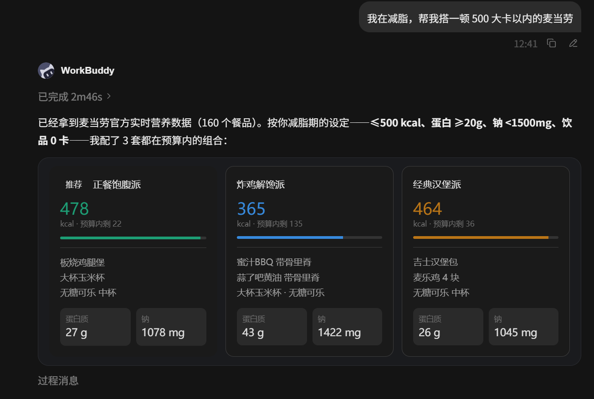
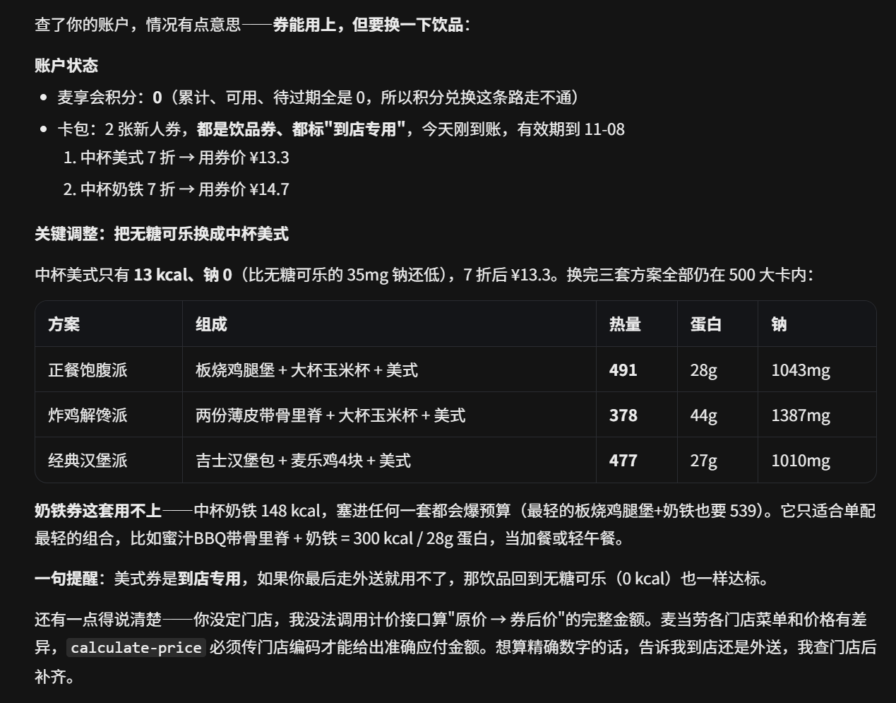

# 🥗 麦麦健康搭子 (McDonald's Health Buddy)

> 2026 麦当劳程序员节 · 创意开发大赛参赛作品
> 项目地址：https://github.com/Qiqian07/mcd-health-buddy
> 基于麦当劳中国官方 MCP 能力开发的 Skill：**按热量/营养目标智能搭配套餐，再自动叠加优惠券和积分，算出最健康的省钱吃法。**

## 💡 为什么做这个

点麦当劳的人大致分两种：一种闭眼点快乐就行，另一种想在热量表面前保持体面。市面上的点餐助手解决的是"怎么买"，**麦麦健康搭子解决的是"怎么吃得又健康又划算"**——用官方营养数据做科学搭配，用券和积分把账单打下来。

一句话：**先讲营养，再算优惠。**

## 👥 目标用户

- **热量管理人群**：减脂期、健身期仍想吃麦当劳，需要知道"这顿到底多少卡"
- **高蛋白需求者**：训练日想优先补足蛋白质，同时控制钠摄入
- **精打细算的麦门信徒**：既想吃得健康，又不想放弃优惠券和积分羊毛
- **懒得比对的人**：不想在 App 里来回切换查营养、翻卡包、算积分，希望一句话搞定

## ✨ 核心功能

| 功能 | 说明 | 用到的 MCP 工具 |
| --- | --- | --- |
| 🎯 健康搭配 | 按热量目标（≤400/600/800 kcal）+ 蛋白质/钠偏好，从真实营养数据中智能组合 2~3 套方案 | `list-nutrition-foods` |
| 🏪 门店可售校验 | 确认推荐组合在附近门店/配送范围内实际有售，无售自动替换相近餐品 | `query-nearby-stores` / `delivery-query-addresses` / `delivery-query-stores` / `query-meals` / `query-meal-detail` |
| 💰 省钱报告 | 原价 → 券后价 → 积分组合价，逐级比价并标注省钱金额 | `query-my-account` / `query-my-coupons` / `query-store-coupons` / `calculate-price` |
| 🎫 一键领券 | 卡包较空时引导领取麦麦省全部可用券 | `available-coupons` / `auto-bind-coupons` |
| 🏆 积分最优解 | 积分商城里有方案内餐品券时，自动比较"直接买 vs 积分兑换" | `mall-points-products` / `mall-product-detail` |
| 📅 活动联动 | 结合当月活动日历提醒"哪天吃更划算" | `campaign-calendar` |
| 🎰 积分抽奖联动 | 先抽券再点单，抽中的餐品券直接并入健康方案当作 0 元加餐重新核算 | `query-lottery-info` / `draw-lottery` / `query-my-prizes` |
| 🎉 主题活动预约 | 麦当劳派对/品鉴会逐级预约，并给出"当天其他两餐热量预算"提示 | `query-party-city` / `query-party-store` / `query-partystore-date` / `query-partystore-session` / `party-order-create` |
| 🛵 安心下单 | 展示完整订单摘要、用户确认后才创建订单并返回支付链接；支持取消与历史订单查询 | `create-order` / `query-order` / `cancel-order` / `order-list` / `delivery-create-address` |

## 💬 使用示例

```text
用户：我在减脂，中午想吃麦当劳，600 大卡以内，最好蛋白质高一点。

麦麦健康搭子：
① 从营养数据筛出 2~3 套 ≤600 kcal、高蛋白的组合（如板烧鸡腿堡+零度可乐+玉米杯）
② 查询附近门店确认有售，缺货自动替换
③ 叠加你的卡包券 + 门店券，给出省钱报告：
   原价 ¥52.0 → 券后 ¥41.5 → 若用积分兑换饮品券可再省 ¥6.5
④ 询问："要按方案 A 帮你下单吗？"
```

```text
用户：巨无霸多少卡？
麦麦健康搭子：巨无霸 558 kcal（2334 kJ），蛋白质 25g，钠 1082mg……
（单点咨询直接返回营养数据，无需走完整流程）
```

## 📸 实测演示

真实运行截图，全部数据来自麦当劳官方 MCP 实时接口（`list-nutrition-foods` 返回 160 个餐品的营养数据）：

**① 一句话报目标，秒出三套达标方案**

> 输入："我在减脂，帮我搭一顿 500 大卡以内的麦当劳"

按 ≤500 kcal、蛋白 ≥20g、钠 <1500mg、饮品 0 卡的约束，从 160 个餐品中配出 3 套组合，每套标注总热量、蛋白质、钠：



**② 真实账户联动——券怎么用、积分够不够，它替你算**

查询卡包与积分后主动调整方案：把无糖可乐换成 7 折券覆盖的中杯美式（13 kcal、钠 0，比原饮品更低），三套方案重新核算后仍然全部达标；并说明奶铁券为何"用了就爆预算"——不是无脑塞券，而是营养约束下的最优解：



## 🚀 快速开始

### 1. 申请麦当劳 MCP Token

访问麦当劳 MCP Server 开放平台官网 [open.mcd.cn/mcp](https://open.mcd.cn/mcp) → 右上角【登录】（手机验证码）→【控制台】→【激活】→ 同意协议后复制 Token。

> ⚠️ 别搞混：`open.mcd.cn/mcp` 是**申请 Token 的官网**（人访问的网页）；`mcp.mcd.cn` 是 **MCP 服务端点**（程序调用的 API），用浏览器打开只会返回 `{"code":"0001","msg":"系统错误"}`，属正常现象。

### 2. 在 WorkBuddy 中接入麦当劳 MCP Server

官方 Server 为远程托管，使用 Streamable HTTP 协议：

```json
{
  "mcpServers": {
    "mcd-mcp": {
      "type": "streamablehttp",
      "url": "https://mcp.mcd.cn",
      "headers": {
        "Authorization": "Bearer YOUR_MCP_TOKEN"
      }
    }
  }
}
```

将 `YOUR_MCP_TOKEN` 替换为你的实际 Token（仓库内 `mcp-config.example.json` 为脱敏示例，仅含环境变量占位符）。详细接入与调用流程见 [MCP_INTEGRATION.md](MCP_INTEGRATION.md)。

### 3. 安装本 Skill

将本仓库的 `SKILL.md` 安装到 WorkBuddy（用户级：`~/.workbuddy/skills/mcd-health-buddy/`），然后在对话中说：

> "我在减脂，帮我搭一顿 500 大卡以内的麦当劳"

## 📁 项目结构

```text
mcd-health-buddy/
├── SKILL.md                   # 项目主体：Skill 本体（WorkBuddy Skill 规范）
├── README.md                  # 项目介绍、安装方法、使用示例、目标用户
├── CONTEST_DECLARATION.md     # 参赛声明（官方原文件，内容未改动）
├── MCP_INTEGRATION.md         # MCP 接入说明：使用的 Server、Tool、调用流程与业务价值
├── mcp-config.example.json    # 脱敏后的 MCP 配置示例（仅环境变量占位符）
├── workbuddy.md               # WorkBuddy 开发对话上下文（专项奖励核验用）
├── docs/
│   └── images/                # 实测演示截图
└── submissions/
    └── issue-报名内容.md      # 按官方 Issue 模板填写的报名内容
```

## 🛠 技术说明

- **零代码**：纯 Skill（提示词工程）实现，所有数据与交易能力均来自麦当劳中国官方 MCP Server 的 20+ 个工具，不引入任何非官方接口
- **数据真实性**：营养与价格全部来自 MCP 实时数据，返回的 toon 紧凑格式在 Skill 内显式解析
- **资金安全**：下单类工具（create-order / mall-create-order）设有强制确认环节，先展示订单摘要、用户明确同意后才执行
- **限流友好**：官方限制 600 次/分钟/Token，Skill 内控制调用节奏，429 时自动退避提示

## 📋 参赛信息

- 大赛：麦当劳程序员创意开发大赛（2026.10.9 10:30 — 10.25 23:59）
- 官方 MCP 仓库：[M-China/mcd-mcp-server](https://github.com/M-China/mcd-mcp-server)
- 开发工具：腾讯 WorkBuddy（[workbuddy.cn](https://www.workbuddy.cn/)）
- 活动主页：[M-China/mcd-developer-innovation-challenge](https://github.com/M-China/mcd-developer-innovation-challenge)
- 参赛声明见 [CONTEST_DECLARATION.md](CONTEST_DECLARATION.md)
- WorkBuddy 开发对话上下文见 [workbuddy.md](workbuddy.md)

## 📄 License

MIT
